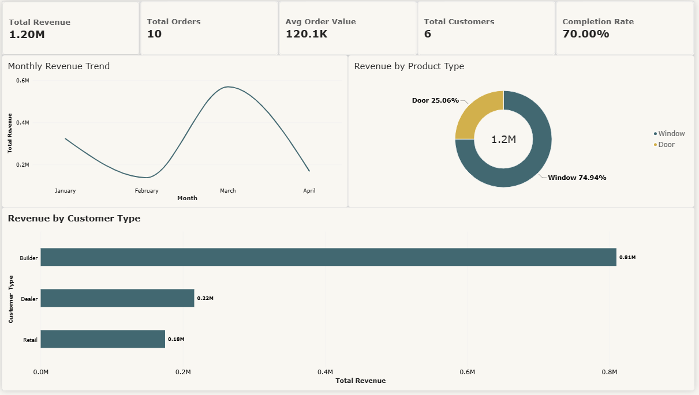

# UPVC Manufacturing Operations Analysis

SQL and Power BI analysis of orders, customers and marketing campaigns for a UPVC windows and doors manufacturer. The project shows how I design a small relational database, answer business questions with SQL (CTEs, window functions, CASE WHEN) and present the results in a 3-page Power BI dashboard.

> **Data note:** the dataset is a small sample (3 tables, 10 orders) modelled on the type of operations I managed at a UPVC manufacturer. Figures are illustrative and are not real company results.

## 📊 Power BI Dashboard



A 3-page interactive dashboard built on this dataset:

- **Executive Summary**: KPIs, monthly revenue trend, product mix
- **Customer Analytics**: customer tiering (VIP / Regular / Occasional), revenue by city
- **Operations**: order status, monthly orders, product by customer-type matrix

**Built with:** Power BI Desktop, DAX, Power Query · 📂 [Full dashboard documentation →](powerbi_dashboard/README.md)

---

## 📋 Business Problem

A UPVC windows and doors manufacturer needed to understand its revenue trends, customer behaviour and marketing performance to make data-driven decisions.

## 🎯 Objectives

- Analyse monthly revenue trends and identify seasonal patterns
- Identify top customers by revenue and segment them (VIP / Regular / Occasional)
- Analyse product mix (Windows vs Doors) and its contribution to revenue
- Rank customers per city to find regional top performers
- Measure marketing campaign performance (cost per lead, ROI)

## 🛠️ Tools Used

- **MySQL**: database design, data storage and all analysis queries
- **Power BI**, **DAX** and **Power Query**: interactive dashboard

## 🗄️ Database Schema

Three tables:

- **customers**: customer_id, customer_name, city, customer_type
- **orders**: order_id, customer_id, order_date, product_type, quantity, amount, status
- **campaigns**: campaign_id, platform, start_date, spend, leads_generated

## 🔍 Key SQL Techniques Used

- **Joins:** INNER JOIN, LEFT JOIN
- **Aggregations:** GROUP BY, HAVING, SUM, COUNT, AVG
- **Window functions:** RANK, DENSE_RANK, LAG
- **Common Table Expressions (CTEs)**
- **Subqueries:** scalar, multi-row, correlated
- **CASE WHEN** for conditional logic and customer segmentation
- **Date functions:** DATE_FORMAT, DATEDIFF, YEAR, MONTH

## 📊 Key Insights

On the sample dataset (₹1.20M revenue from 10 orders):

- **January 2024** was the highest revenue month, with over ₹320,000 from completed orders
- **Builders** were the largest customer segment, with ₹810K of the ₹1.2M revenue
- **Windows** are the dominant product, generating about 70% of revenue
- **Order status:** 70% completed, 20% pending, 10% cancelled
- **Cities:** Mumbai is the top revenue city (₹0.49M), followed by Bangalore (₹0.36M)
- **Campaigns:** Facebook had the lowest cost per lead, while IndiaMART delivered the highest volume of leads

## 📁 Repository Structure

```
upvc-sql-analysis/
├── 01_database_setup.sql     # Schema and sample data
├── 02_analysis_queries.sql   # All analysis queries
├── powerbi_dashboard/        # Dashboard screenshots and documentation
└── README.md
```

## 🚀 How to Run

1. Open MySQL Workbench.
2. Run `01_database_setup.sql` to create the database and tables.
3. Run `02_analysis_queries.sql` to execute the analysis.

## 👤 Author

**Yusuf Baig**, Data Analyst | Open to roles in Dubai, UAE

- LinkedIn: [yusuf-baig-783906210](https://www.linkedin.com/in/yusuf-baig-783906210/)
- GitHub: [@Yusufbaig2001](https://github.com/Yusufbaig2001)
