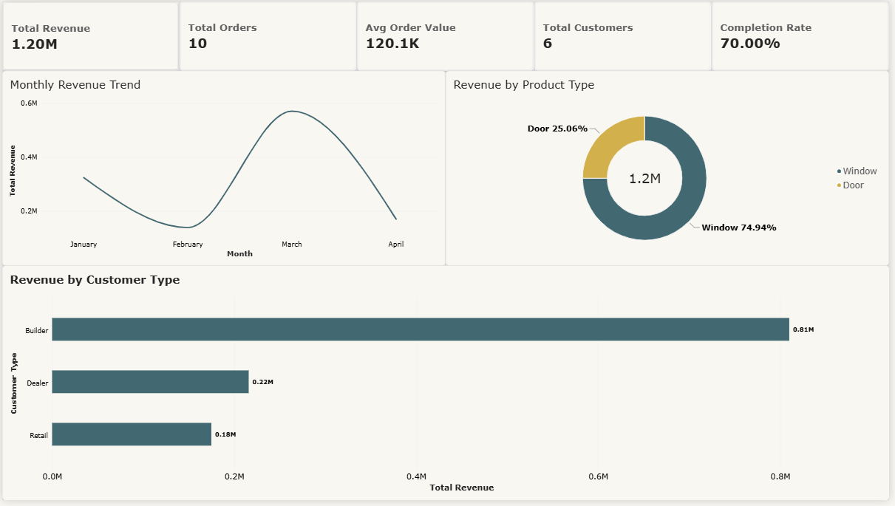
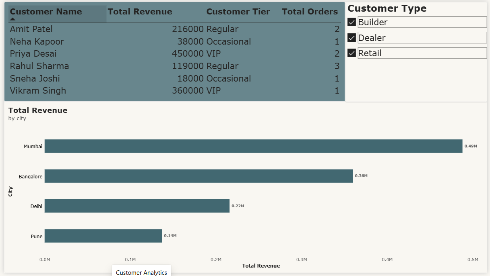
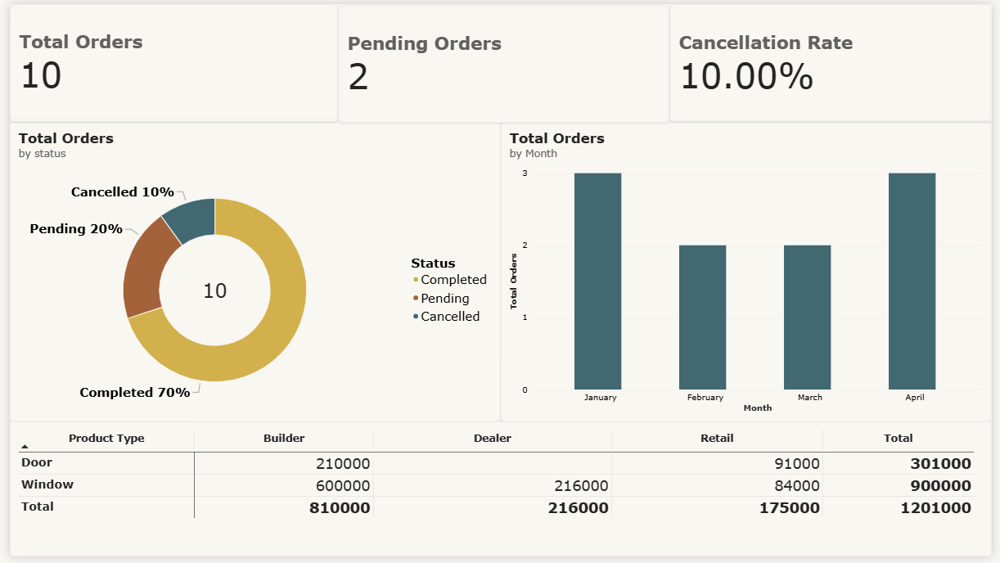

# Power BI Dashboard — UPVC Sales & Customer Analytics

An interactive three-page Power BI dashboard exploring sample UPVC sales orders, customer segments, product categories, and order statuses.

> **Dataset note:** This project uses an illustrative dataset containing 6 customers, 10 orders, and 4 marketing campaigns. The figures are not actual company financial results.

## Dashboard Pages

### Page 1 — Executive Summary



**Key metrics displayed:**
- Total recorded order value: approximately ₹1.20M
- Total orders: 10
- Average order value: approximately ₹120.1K
- Order completion rate: 70%

**Visuals:**
- Monthly order value trend
- Product mix: Windows vs Doors
- Order value by customer type

**Metric clarification:** Total recorded order value includes all order statuses unless a visual or measure specifically filters completed orders. It should not automatically be interpreted as completed sales revenue.

### Page 2 — Customer Analytics



**Key observations from the sample data:**
- Customer rankings based on recorded order value
- Mumbai has the highest recorded order value (approximately ₹0.49M)
- Bangalore follows with approximately ₹0.36M
- Customer segmentation into VIP, Regular, and Occasional categories

**Visuals:**
- Customer-level order value
- City-wise order value
- Customer segmentation

### Page 3 — Order Status & Product Analysis



**Key observations:**
- 70% of orders are completed
- 20% are pending
- 10% are cancelled
- Builders account for approximately ₹810K in recorded order value

**Visuals:**
- Order status distribution
- Monthly order trend
- Product category vs customer type

**Metric clarification:** Order status percentages represent the share of orders by count. The Builders figure represents recorded order value and may include pending or cancelled orders.

## Tools & Technologies

- Power BI Desktop
- DAX
- Power Query
- MySQL

## Example DAX Measures

```dax
Total Recorded Order Value =
SUM(orders[amount])

Total Orders =
COUNT(orders[order_id])

Average Order Value =
DIVIDE(
    [Total Recorded Order Value],
    [Total Orders]
)

Completed Orders =
CALCULATE(
    COUNT(orders[order_id]),
    orders[status] = "Completed"
)

Completion Rate =
DIVIDE(
    [Completed Orders],
    [Total Orders]
)
```

## Repository Files

| File | Description |
|---|---|
| `upvc_dashboard.pbix` | Power BI dashboard source file |
| `page1_executive.png` | Executive Summary screenshot |
| `page2_customers.png` | Customer Analytics screenshot |
| `page3_operations.png` | Order Status & Product Analysis screenshot |

## Project Limitations

- The dataset contains only 10 illustrative orders.
- Pending and cancelled orders should not be treated as completed sales.
- The analysis focuses on sales orders, customers, products, and order statuses.
- The dataset does not contain machine output, production defects, material consumption, or manufacturing efficiency data.
- Findings demonstrate analytical techniques and are not statistically reliable business conclusions.

## Learning Outcomes

- Building interactive Power BI dashboards
- Creating DAX measures
- Analysing customer and product performance
- Presenting order status and sales patterns
- Communicating data limitations clearly

**Development note:** AI tools assisted with parts of the SQL development, documentation, and analytical workflow. The project is also being used to strengthen practical data-analysis skills.
